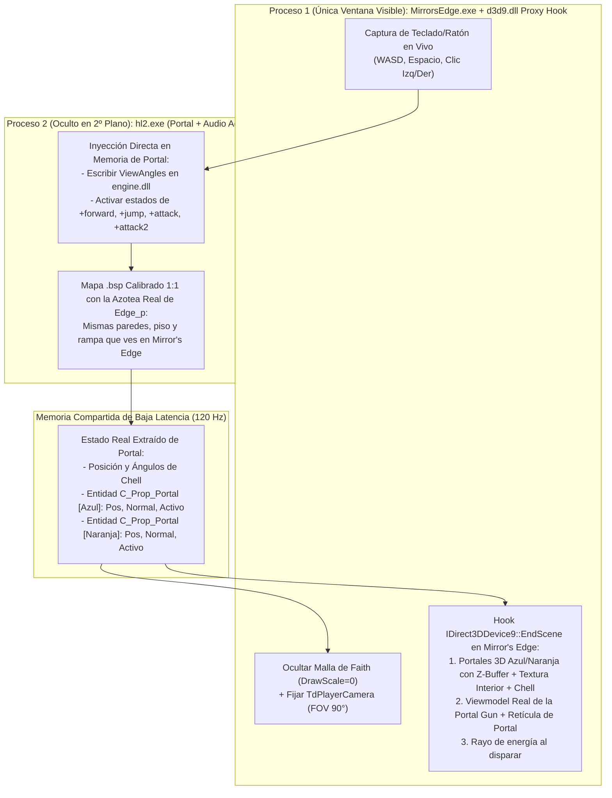

> [!IMPORTANT]
> **Estado: ARCHIVADO (`status: archivado` por `ADR-006`, 2026-11-03).**
> El proyecto activo es **ApertureRunner** (*Mirror's Edge dentro de Portal*, mapa `testchmb_a_00`; ver [`PLAN_EQUIPO.md`](../../../PLAN_EQUIPO.md)). Esta skill no se borra: se conserva como referencia técnica (offsets de Mirror's Edge GOG, offsets de `client.dll` de Portal y notas de integración). Consulta [`docs/artifacts/2026-11-03-archivado-portal-me-y-reutilizacion-adr006.md`](../../../docs/artifacts/2026-11-03-archivado-portal-me-y-reutilizacion-adr006.md).

# Flujo de Trabajo `segundo-intento` v2: True In-Game Pass-Through en *Mirror's Edge* (`portal-me-true-ingame-v2`)

> **Por qué existe este flujo (Lección del Post-Mortem de `primer-intento`)**:
> En `primer-intento` (`portal-me-lean-slice`) cometimos el error de reducir el mod a un sincronizador externo de coordenadas `(X, Y, Z)` entre dos ventanas separadas, obligando al jugador a jugar dentro de una caja gris en *Portal* sin ver la *Portal Gun*, ni a Chell, ni los portales en *Mirror's Edge*.
>
> En **`segundo-intento` (`portal-me-true-ingame-v2`)**, el usuario juega **100% dentro de la única ventana de *Mirror's Edge***, viendo la **Portal Gun en primera persona**, la **retícula oficial de *Portal***, los **portales Azul y Naranja en 3D con profundidad (`Z-Buffer`) e imagen interior** sobre los muros reales de la azotea de `Edge_p`, y a **Chell**, mientras *Portal* (`hl2.exe`) opera en segundo plano como coprocesador físico y de audio.

---

## Arquitectura de 4 Módulos Técnicos



---

## Paso a Paso de Implementación (Los 4 Módulos)

### Módulo 1: Extracción de la Geometría Exacta de la Azotea Real de `Edge_p` $\rightarrow$ `.bsp` 1:1
1. **Problema que resuelve**: Evita que los portales queden flotando en el aire o enterrados detrás de las paredes reales de *Mirror's Edge*.
2. **Procedimiento**:
   - Extraer las coordenadas exactas del piso (`Z = 8517.2 UU` / `15180.0 UU`), muros perimetrales, parapetos y rampa de la azotea activa de `Edge_p` en `MirrorsEdge.exe`.
   - Convertir dichas superficies con la transformación exacta (`1 HU = 1.905 UU`, inversión del eje `Y`) para compilar el `.bsp` de *Portal* con `vbsp.exe -game "<PortalDir>/portal"`.
   - Garantizar correspondencia 1:1 entre cada pared blanca visible en *Mirror's Edge* y cada superficie `portalable` en *Portal*.

### Módulo 2: Control 100% en Memoria sin Cambiar de Ventana (*Memory Input Injection* + Audio Unificado)
1. **Problema que resuelve**: Permite jugar siempre dentro de *Mirror's Edge* sin cambiar de ventana ni sufrir tirones de foco.
2. **Procedimiento**:
   - Capturar en tiempo real la rotación de cámara y las teclas presionadas cuando `MirrorsEdge.exe` es la ventana activa (`W, A, S, D, Espacio, Clic Izquierdo, Clic Derecho`).
   - Inyectar los ángulos de vista directamente en `engine.dll` (`ViewAngles`) de *Portal* y accionar los comandos de movimiento/disparo (`+forward`, `+back`, `+moveleft`, `+moveright`, `+jump`, `+attack`, `+attack2`) en segundo plano sin robar el foco de Windows.
   - Configurar `snd_mute_losefocus 0` en *Portal* para que los sonidos reales de la *Portal Gun* y la apertura/atravesamiento de portales se escuchen mientras juegas en *Mirror's Edge*.

### Módulo 3: Lectura Real de las Entidades `C_Prop_Portal` desde `client.dll` de *Portal*
1. **Problema que resuelve**: Garantiza que la posición y orientación de los portales dibujados en *Mirror's Edge* sean las mismas donde *Portal* ejecuta el teletransporte y la conservación de momento (*Fling*).
2. **Procedimiento**:
   - Recorrer la `cl_entitylist` en `portal/bin/client.dll` para localizar las dos instancias de `C_Prop_Portal` (`m_iLinkageGroupID = 0`, `m_bIsPortal2 = 0` para Azul y `1` para Naranja).
   - Leer en cada tick a 120 Hz:
     - `m_vecOrigin` `(X, Y, Z)` en Unidades Hammer (`HU`) $\rightarrow$ convertir a `UU` de *Mirror's Edge*.
     - `m_angAngles` `(Pitch, Yaw, Roll)` $\rightarrow$ calcular vectores `Forward (Normal)`, `Right` y `Up` en espacio UE3.
     - `m_bActivated` (si el portal está abierto) y `m_hLinkedPortal` (si ambos portales están enlazados).

### Módulo 4: Hook Nativo `d3d9.dll` dentro de `MirrorsEdge.exe` (Portales 3D + Vista Interior + Chell + Viewmodel de Portal Gun)
1. **Problema que resuelve**: Incorpora visualmente los elementos de *Portal* dentro del motor gráfico de *Mirror's Edge*.
2. **Procedimiento**:
   - Compilar un DLL proxy x86 (`d3d9.dll` / [`src/true_ingame_v2/me_true_ingame_d3d9.cpp`](../../../src/true_ingame_v2/me_true_ingame_d3d9.cpp)) para `Mirror's Edge/Binaries/` que intercepta `IDirect3DDevice9::EndScene`.
   - **Ocultar a Faith**: Ajustar `DrawScale = 0` (`Pawn + 0x10C`) y fijar `TdPlayerCamera` (`Controller + 0x2D0`) con `FOV = 90°` a la posición de ojos de Chell.
   - **Renderizar los Portales 3D con Z-Buffer y Vista Interior**:
     - Construir la matriz `ViewProjection` desde `TdPlayerCamera` y proyectar en 3D las elipses del **Portal Azul (`#00A2FF`)** y **Portal Naranja (`#FF6A00`)** adheridas a la superficie real de la azotea.
     - Renderizar en el interior del óvalo la vista proyectada del destino y la figura 3D de **Chell** cuando ambos portales están activos.
   - **Renderizar el Viewmodel de la Portal Gun y la Retícula**:
     - Dibujar en una pasada final (con limpieza de rango Z `MinZ=0.0, MaxZ=0.08` para evitar *clipping* con muros) la **Portal Gun en primera persona** (con iluminación central azul/naranja, retroceso al disparar y haz de energía hacia el punto de impacto) y la retícula central oficial de *Portal*.

---

## Comando Único de Construcción, Compilación (`.bsp` + `x86`) y Verificación

Ejecuta el script todo-en-uno ([`build-and-verify-true-ingame-v2.js`](./scripts/build-and-verify-true-ingame-v2.js)) que genera el `.vmf` 1:1 desde [`levels/edge_p_true_ingame_v2/slice_manifest.json`](../../../levels/edge_p_true_ingame_v2/slice_manifest.json), compila [`me_edge_true_ingame_v2.bsp`](../../../levels/edge_p_true_ingame_v2/me_edge_true_ingame_v2.bsp) con `vbsp.exe`, compila `me_true_ingame_d3d9.dll` y `true_ingame_bridge_v2.exe` con `vcvars32.bat`, y ejecuta `--self-test` sobre los 4 módulos:

```powershell
node .agents/skills/portal-me-true-ingame-v2/scripts/build-and-verify-true-ingame-v2.js
```

### Archivos de Implementación de los 4 Módulos
- **Contrato IPC v2 (`PTV2`)**: [`src/common/ipc_true_ingame_v2.h`](../../../src/common/ipc_true_ingame_v2.h)
- **Módulo 1 (Manifiesto + `.vmf` + `.bsp` 1:1)**: [`levels/edge_p_true_ingame_v2/slice_manifest.json`](../../../levels/edge_p_true_ingame_v2/slice_manifest.json)
- **Módulo 2 y 3 (Inyección en Memoria + `C_Prop_Portal`)**: [`src/true_ingame_v2/true_ingame_bridge_v2.cpp`](../../../src/true_ingame_v2/true_ingame_bridge_v2.cpp)
- **Módulo 4 (Hook Proxy `d3d9.dll` `EndScene`)**: [`src/true_ingame_v2/me_true_ingame_d3d9.cpp`](../../../src/true_ingame_v2/me_true_ingame_d3d9.cpp)

---

## Offsets Base Verificados (GOG v1.01 + Steam 2025)
- **`MirrorsEdge.exe` (GOG v1.01, `ImageBase = 0x00400000`)**:
  - `GEngine = 0x01FF8B20` $\rightarrow$ `+0x2BC` (`GamePlayers.Data[0]`) $\rightarrow$ `+0x40` (`ATdPlayerController`) $\rightarrow$ `+0x1C0` (`ATdPlayerPawn`) y `+0x2D0` (`TdPlayerCamera`).
  - `AActor::Location = +0x0E8`, `AActor::Rotation = +0x0F4`, `AActor::ColLocation = +0x13C`, `ATdPawn` cápsula interna `= +0x2E0` y `+0x2F8`.
- **`Portal/portal/bin/client.dll` (Steam 2025, `Timestamp 0x68362D89`)**:
  - `MainViewOrigin = +0x0050F484`, `MainViewAngles = +0x0050F490`, `s_pLocalPlayer = +0x004D78F0`.

---

## Guardarraíles Operativos (No Repetir Errores Resueltos)

1. **Prohibido modificar `TdGame\Config\Default*.ini` en la carpeta de instalación de *Mirror's Edge***:
   - *Mirror's Edge* verifica el hash SHA-1 de `DefaultInput.ini` y `DefaultEngine.ini` al arrancar y bloquea el juego con `The file ..\TdGame\Config\DefaultInput.ini is corrupt`.
   - Todo bind (`F7 = start Edge_p`, `F8 = SETRES 960x540w`) o ajuste de ventana (`Fullscreen=False`) debe escribirse exclusivamente en `Documents\EA Games\Mirror's Edge\TdGame\Config\TdInput.ini` y `TdEngine.ini`, preservando saltos de línea `CRLF` y la sección `[IniVersion]`.
2. **No depender de `CheatManager` (`Ghost` / `F10`) en *Mirror's Edge* Retail**:
   - `ATdCheatManager` está deshabilitado en campaña/tutorial retail. Para desactivar gravedad y mover la cámara sin temblor (*rubberbanding*) a 120 Hz, escribe directamente en memoria:
     - `Pawn + 0x06B = 4` (`PHYS_Flying`) y `Pawn + 0x100 = (0,0,0)` (`Velocity`).
     - `Pawn + 0x0E8` (`Location`), `Pawn + 0x13C` (`ColLocation`), `Pawn + 0x2E0` y `Pawn + 0x2F8` (cápsula interna de parkour de `ATdPawn`).
     - `TdPlayerCamera` (`*(Controller + 0x2D0)`) `+ 0x0E8` (`Location`) y `+ 0x0F4` (`Rotation`).
3. **Compilación de Mapas (`.bsp`) y Binarios x86 (32 bits)**:
   - `vbsp.exe` requiere siempre el flag `-game "<PortalDir>/portal"` para encontrar `gameinfo.txt`.
   - Tanto `MirrorsEdge.exe` como `hl2.exe` son procesos de **32 bits (`x86`)**: todo puente o DLL proxy (`d3d9.dll`) debe compilarse con `vcvars32.bat` + `cl /EHsc /O2`.
