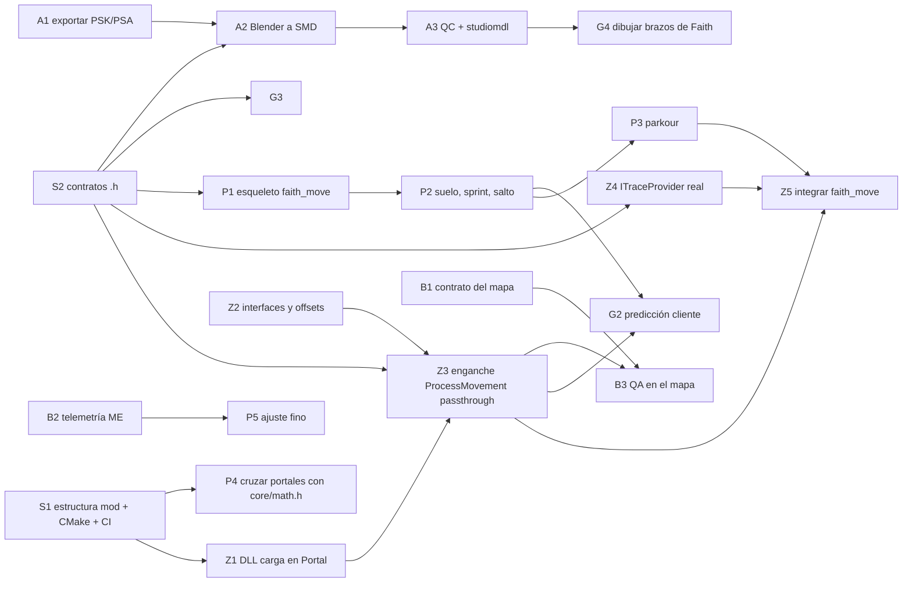

# Plan de equipo: Mirror's Edge dentro de Portal (ApertureRunner)

> **Lee esto completo una vez. Después solo busca tu nombre (`Ctrl+F`).**
> Cada persona tiene sus tareas, sus agentes de Antigravity y la lista de qué puede hacer ya y qué tiene que esperar.
> Informe técnico completo (en inglés, con fuentes): https://app.notion.com/p/40d1d50b074681eda477ce985f070297

> **Estado (2026-11-03): S0, S1 y S2 están hechos y en `main`.**
> - Los contratos v1 están en `mod/include/ar/`: `faith_movement.h`, `trace_provider.h`, `units.h` y `testing/box_world.h` (un mundo de cajas para probar sin el juego). Ya no hace falta inventar stubs de S2: usa los headers reales.
> - Compilar y probar: `mod\build.bat`. Los agentes están en `.agents/agents/` y las skills `build-x86` y `launch-portal-test` en `.agents/skills/`.

---

## 0. Qué vamos a hacer (en 1 minuto)

- **Objetivo:** jugar **el primer nivel de Portal 1** (`testchmb_a_00`, cámaras 00 y 01) **moviéndote como Faith de Mirror's Edge**. Eso incluye sprint con inercia, wallrun, escalar paredes, agarrarse a bordes, deslizarse y rodar al caer. También se ven los brazos y el cuerpo de Faith en primera persona.
- **Una sola ventana: Portal.** Una DLL nuestra (plugin x86) se carga dentro de Portal, sustituye el movimiento de Chell por el de Faith y dibuja a Faith.
- **Necesitas los dos juegos originales.** Portal sirve para jugar. Mirror's Edge es de donde sale el modelo de Faith, que cada uno genera en su PC desde su propia copia, y donde se miden las referencias de movimiento. **No subimos al git ningún archivo de los juegos.**
- **Todo lo de la cámara tiene que seguir funcionando:** el despertar, los portales fijos con temporizador, la caja, los botones, el desintegrador, las puertas y el ascensor del final.
- Fuera de alcance: GLaDOS hablando, otros niveles, geles, torretas y pistola de portales (en este mapa no la hay).

### ⚠️ Cambio de dirección (léelo si trabajaste antes en esto)

- Hasta el 2026-11-02 el repo seguía la idea contraria: **Portal dentro de Mirror's Edge** (azotea de `Edge_p`, flujos de Benja, ADR-002 a ADR-005).
- **Desde el 2026-11-03 la dirección es Mirror's Edge dentro de Portal** (ADR-006, en `.agents/memory/DECISIONS.md`).
- Los flujos anteriores **no se borran**. Quedan como referencia en `.agents/skills/portal-me-*` y `levels/`, y varias cosas se reutilizan:
  - los offsets de Mirror's Edge GOG;
  - los offsets de `client.dll` de Portal;
  - el conocimiento de `TdInput.ini` y `TdEngine.ini`;
  - el sistema de memoria compartida de Antigravity.
- No sigas las skills `portal-me-true-ingame-v2`, `portal-me-lean-slice`, `portal-mirrors-edge-passthrough` ni `portal-mirrors-edge-stormdrain` para trabajo nuevo.

---

## 1. Quién hace qué

| Persona | Área | Carpeta que es SUYA (solo él la edita) | Necesita instalado |
|---|---|---|---|
| **Sebas** (líder, Claude Code) | Arquitectura, contratos, integración, revisión de PRs | `mod/include/`, `mod/core/`, `mod/CMakeLists.txt`, `docs/contratos/` (salvo lo de Benja), `PLAN_EQUIPO.md` | Portal, VS 2022 C++ |
| **Zarek** | Plugin de servidor (la DLL, el enganche del movimiento) | `mod/plugin/server/`, `mod/plugin/main.cpp` | Portal, VS 2022 C++ (x86) |
| **Peña** | Librería de movimiento de Faith | `mod/faith_move/` | VS 2022 C++ (Portal para probar) |
| **Gonzalo** | Lado cliente: predicción, cámara, dibujar a Faith | `mod/plugin/client/`, `mod/camera/` | Portal, VS 2022 C++ (x86) |
| **Antonio** | Modelo y animaciones de Faith (pipeline de assets) | `mod/tools/extractor/`, `mod/assets_src/` (solo scripts y QC, nunca archivos del juego) | Mirror's Edge (**GOG recomendado**, sin DRM), Portal, Blender 5.0, UEViewer |
| **Benja** | Telemetría de Mirror's Edge, contrato del mapa y QA | `mod/tools/me_telemetry/`, `qa/`, `docs/contratos/testchmb_a_00*` | Mirror's Edge (ya tiene GOG), Portal, VS 2022 C++ |

> Si alguien prefiere otra área, se cambia el nombre en esta tabla y en su sección. Las tareas no cambian.

---

## 2. Leyenda de dependencias

- 🟢 **PARALELO**: empieza ya. No depende de nadie.
- 🟡 **PARALELO CON STUB**: empieza ya con un "stub" (versión falsa o mínima de lo que te falta). Cuando llegue lo real, cambias el stub por lo real y subes.
- 🔴 **ESPERA**: no empieces hasta que esté **fusionado en `main`** lo que dice entre paréntesis. Mientras tanto, haz tus 🟢.

Cada tarea tiene un ID (`S2`, `Z3`…). Úsalo en el nombre de la rama y en el título del PR.

---

## 3. Mapa de dependencias



### Hitos (cuando todos se juntan)

| Hito | Cuándo (estimado) | Qué tiene que funcionar | Tareas que lo cierran |
|---|---|---|---|
| **H1: "La DLL vive"** | fin de semana 1 | Portal carga nuestra DLL en `testchmb_a_00`, el movimiento pasa por nuestro hook sin cambiar nada (passthrough) y todo el mapa sigue funcionando | S1, S2, Z1, Z2, Z3, B1 |
| **H2: "Corre como Faith"** | fin de semana 3 | Sprint con inercia y salto de Faith en el mapa, servidor y cliente sin tirones | P1, P2, Z4, Z5, G2, G3 |
| **H3: "Parkour completo"** | fin de semana 6 | Wallrun, escalar, borde, deslizar, rodar, cruzar portales con inercia, brazos de Faith visibles | P3, P4, A3, G4, B3 |
| **H4: "Se siente como Mirror's Edge"** | fin de semana 8 | Ajuste fino con datos reales de ME, extractor en un comando, vídeo | P5, A4, B4, B5, S5 |

> Las fechas son estimaciones, no compromisos. Si un hito se atrasa, Sebas reordena.

---

## 4. Reglas para todos (Git con GitHub Desktop)

1. **Al empezar el día:** GitHub Desktop → `Fetch origin` → `Pull origin` en `main`.
2. **Una rama por tarea:** `Current branch` → `New branch` → `nombre/ID-descripcion`, por ejemplo `zarek/Z1-dll-carga` o `pena/P2-sprint-salto`.
3. **Solo editas tu carpeta** (tabla de la sección 1). Si necesitas cambiar algo de otro, pídeselo o abre un *issue*. **Los contratos (`mod/include/`) solo los cambia Sebas.**
4. **Commits pequeños:** `tipo(ID): qué hiciste`, por ejemplo `feat(Z1): la DLL imprime versión al cargar`. Los tipos son `feat`, `fix`, `test`, `docs` y `chore`.
5. **Para entregar:** `Push origin` → `Create Pull Request` → título `[ID] descripción` → asigna a **Sebas**. Sebas revisa y fusiona. **Nadie hace push directo a `main`** (salvo Sebas para contratos y docs).
6. **Antes del PR, comprueba:**
   - [ ] Compila en **x86 / Win32** (Portal es de 32 bits; una DLL x64 no carga).
   - [ ] Pasan las pruebas de tu carpeta.
   - [ ] No hay archivos de los juegos: nada de `.upk`, `.umap`, `.psk`, `.psa`, `.mdl`, `.vtx`, `.vvd`, `.bsp`, `.dll`, `.exe`. El `.gitignore` bloquea casi todo, pero revisa la pestaña *Changes*.
   - [ ] No hay contraseñas, API keys ni rutas personales (usa `config/paths.local.json`, que no se sube).
   - [ ] Si aprendiste algo útil para otros, añádelo a `.agents/memory/LESSONS.md` (se fusiona solo, sin conflictos).
   - [ ] Añade una línea a `.agents/memory/SESSIONS.md` con tu nombre, la fecha y la tarea.
7. **Código de terceros:**
   - Se puede **copiar** código de licencia MIT (por ejemplo `tnrjns/faith-runner`) citando la fuente, y código del Source SDK 2013.
   - Solo se puede **leer, no copiar**, SourcePauseTool y `btbd/mmultiplayer`: no tienen licencia clara.
   - **Prohibido** usar código filtrado de Portal (`Portal-Base`, `portal-sdk-2013` y similares).

---

## 5. Configuración de Antigravity (cada uno, una vez)

1. Instala la **app de Antigravity** y entra con tu cuenta de **Google AI Pro**.
2. Clona `Atom120/Cerebro_IA` con GitHub Desktop (`File → Clone repository`) y abre la carpeta como **Project** en Antigravity.
3. **Permisos:** usa el preset **"Request Review"** o **"Default"**. **NUNCA "Turbo"** ni `--dangerously-skip-permissions`: Antigravity ha borrado discos enteros en Windows con esos modos.
4. **Modelos:**
   - **Gemini 4 Argon** (`model: pro`) solo para diseño, ingeniería inversa y bugs difíciles. Tiene una cuota semanal aparte que se acaba rápido.
   - **Gemini 3.8 Flash** (`model: flash`) para pruebas, código repetitivo, documentación y compilar.
   - Si te quedas sin cuota, avisa en el grupo y pasa a tus tareas 🟢 más sencillas con Flash.
5. **Si vas a lanzar varios agentes a la vez**, crea el proyecto en **"New worktree"** para que no se pisen.
6. Copia `config/paths.example.json` a `config/paths.local.json` y pon tus rutas de Portal y Mirror's Edge. Ese archivo no se sube.
7. Al abrir un chat, Antigravity ya lee `AGENTS.md`, `.agents/memory/HANDOFF.md` y `LESSONS.md`. No configures nada en `~/.gemini/`: todo lo compartido vive en el repo.
8. **Tus agentes** ya están en `.agents/agents/` (los mismos bloques de tu sección).
   - Para usarlos, pídele al agente principal *"usa el subagente `<nombre>` para…"*.
   - No pongas `tools:` en el archivo: un nombre de herramienta mal escrito deja colgado al subagente.
9. **Agente común para todos:** `reviewer`. Pásalo antes de cada PR: *"usa el subagente reviewer sobre mi rama"*.

```markdown
---
name: reviewer
description: Revisa la rama actual contra PLAN_EQUIPO.md antes de abrir un PR. No edita archivos.
model: pro
---
Eres el revisor del equipo ApertureRunner. Lee PLAN_EQUIPO.md y los contratos en mod/include/.
Revisa el diff de la rama actual contra main y responde en español con una lista:
1. ¿Toca archivos fuera de la carpeta del autor? (sección 1 del plan)
2. ¿Cambia contratos de mod/include/ sin ser Sebas?
3. ¿Compila para Win32/x86? ¿Hay pruebas para lo nuevo?
4. ¿Sube archivos de los juegos, binarios, secretos o rutas absolutas personales?
5. ¿Copia código de fuentes sin licencia (SPT, mmultiplayer, Portal-Base)?
6. Bugs probables (punteros, hilos, unidades UE3↔Source, x86).
No modifiques nada. Termina con "LISTO PARA PR" o "CORREGIR ANTES".
```

---

## 5b. Prompt para empezar (cópialo en Antigravity al abrir cada sesión)

Cambia `<TU NOMBRE>` por Zarek, Peña, Gonzalo, Antonio o Benja:

```text
Soy <TU NOMBRE> del equipo ApertureRunner (Mirror's Edge dentro de Portal, mapa testchmb_a_00).
Antes de cambiar nada:
1. Ejecuta git status y git log -n 5 --oneline. Si mi rama main está atrasada respecto a origin, dime que haga Pull en GitHub Desktop y espera.
2. Lee completos PLAN_EQUIPO.md, .agents/memory/HANDOFF.md y la ADR-006 de .agents/memory/DECISIONS.md.
3. Busca mi sección en PLAN_EQUIPO.md y dame un resumen en español:
   - mi área y las carpetas que son mías;
   - una tabla con cada una de mis tareas (ID, qué es, 🟢/🟡/🔴). Para cada dependencia, comprueba en el repo (archivos y git log) si ya está en main, y di "lista" o "pendiente de <persona> (<ID>)";
   - qué tarea puedo empezar hoy y cuáles tengo que esperar;
   - qué necesito instalado y si lo tengo: Portal build 19017868 (mira steamapps/appmanifest_400.acf), Visual Studio con C++, CMake y, si me toca, Mirror's Edge o Blender. Revisa también si existe config/paths.local.json;
   - mis agentes en .agents/agents/ y cuándo usar cada uno.
4. Ejecuta la skill build-x86 y dime si compila y pasan las pruebas.
5. Propón un implementation plan para mi siguiente tarea 🟢 y espera mi aprobación antes de editar archivos.
Reglas: solo edito mis carpetas; no toco mod/include/ar ni mod/core; no subo archivos de los juegos ni secretos;
trabajo en una rama <mi-nombre>/<ID>-<descripcion>; nada de borrados recursivos ni git reset --hard.
```

Al terminar la sesión: *"prepara el handoff de mi tarea, añade mi línea a SESSIONS.md y dime qué subir"*. Después haz `Commit` y `Push`, y abre el PR a Sebas.

---

## 6. Datos compartidos que todos deben respetar

- **Juego objetivo:** Portal (Steam, app 400), **build 19017868**, **solo 32 bits**, rama Source 2013 Singleplayer (última actualización 2025-06-27). Comprueba el build en `steamapps/appmanifest_400.acf` (`buildid`). Si tu build es otro, avisa antes de buscar firmas u offsets.
- **Mapa:** `maps/testchmb_a_00.bsp`.
  - Resumen de sus 323 entidades: `docs/contratos/testchmb_a_00_entidades.txt`.
  - Lo importante: 8 `prop_portal` fijos, 8 `logic_timer`, 4 `func_portal_detector`, 2 `trigger_portal_cleanser`, la caja y `logic_drop_box`, 2 botones, 9 `func_door`, 5 escenas coreografiadas, el ascensor y `trigger_changelevel` hacia `testchmb_a_01`.
- **Unidades:**
  - Mirror's Edge: 1 uu ≈ 1 cm, mano izquierda, Z arriba, ángulos con 65536 = 360°.
  - Source: 1 unidad = 1 pulgada = 2.54 cm a escala de personaje, mano derecha.
  - **Conversión de movimiento: `source = uu / 2.54`, con el eje Y invertido.** Ya está en `mod/core/.../math.h`.
  - Ojo: `LESSONS.md` menciona 1.905. Ese factor es la escala de **arquitectura** de Source y se usó para los mapas proxy. Para el movimiento de Faith usamos **2.54**, porque Faith mide 180 uu → 71 unidades, igual que Chell (72).
- **Valores de Faith** (por defecto en Mirror's Edge, sacados de `faith-runner`, MIT):

| Valor | uu (ME) | unidades Source (÷2.54) |
|---|---|---|
| Inicio de sprint (`SpeedMaxBaseVelocity`) | 400 | 157.5 |
| Sprint máximo (`GroundSpeed`) | 720 | 283.5 |
| Aceleración (`AccelRate`) | 6144 | 2419 |
| Salto (`BaseJumpZ`) | 630 | 248 |
| Gravedad efectiva de Faith (medida) | ≈1641 /s² | ≈646 /s² |
| Wallrun: velocidad mínima | 200 | 78.7 |
| Wallrun: impulso vertical inicial | 170 | 66.9 |
| Caída dura (`HardLandingHeight`) | 530 | 208.7 |
| Altura de Skill Roll | 200 | 78.7 |

- **Estados de movimiento:** Mirror's Edge tiene 94 (`EMovement`, de `MOVE_None` = 0 a `MOVE_Cutscene` = 93). Nosotros usamos solo el subconjunto de `FaithAnimState` (lo define Sebas en S2).

---

## 7. Tareas por persona

### 🧭 Sebas: líder e integración (Claude Code + plugin universal-modder)

**Agentes:** `mod-orchestrator`, `mod-game-worker` y `mod-offline-worker` (universal-modder), la skill `/code-review` y `Explore` para buscar en todo el repo.

| ID | Tarea | Dependencia | Entregable |
|---|---|---|---|
| S0 | Subir los agentes de este plan a `.agents/agents/` y las skills comunes (`build-x86`, `launch-portal-test`) | 🟢 | Archivos en `.agents/` |
| S1 | Crear `mod/`: mover el núcleo de `aperture-runner-mashup` a `mod/core/`, `CMakeLists.txt` para Win32, CI (GitHub Actions, Windows, x86) | 🟢 | `main` compila en CI |
| S2 | **Contratos** en `mod/include/ar/`: `faith_movement.h` (`FaithInput`, `FaithState`, `FaithAnimState`, `IFaithMovement`), `trace_provider.h` (`ITraceProvider`), `units.h`, y `docs/contratos/asset_manifest.json` | 🟢 **Bloquea a Z3, Z4, P1, G3 y A2. Prioridad máxima, día 1–2** | Headers fusionados en `main` |
| S3 | Build de integración semanal y prueba en Portal | 🔴 (Z3) | Nota de estado semanal en `HANDOFF.md` |
| S4 | Revisar y fusionar PRs; actualizar `DECISIONS.md` si cambia algo | continuo | — |
| S5 | Instalador final (DLL + `addons/aperture_runner.vdf` + extractor) | 🔴 (Z5, A4) | Release |

---

### 🔌 Zarek: plugin de servidor (`mod/plugin/server/`)

**Qué es:** la DLL que Portal carga con `plugin_load`. Engancha el movimiento del jugador en `server.dll` y llama a la librería de Peña.

| ID | Tarea | Dependencia | Entregable |
|---|---|---|---|
| Z1 | DLL mínima x86 que implementa `IServerPluginCallbacks` (versión 003), carga con `plugin_load addons/aperture_runner` en `testchmb_a_00`, imprime el build y registra la ConVar `ar_enable` | 🟢 (usa el CMake de S1 cuando llegue; antes, un proyecto VS suelto) | La DLL carga sin errores |
| Z2 | Obtener por fábrica de interfaces `GameMovement001` (`server.dll`), `PlayerInfoManager002` y `VEngineServer021`. Documentar los campos de `CPortal_Player` que necesitamos (velocidad, flags, duck, ground entity) leyendo sus datamaps, **sin offsets fijos si se puede** | 🟢 | `docs/contratos/portal_server_offsets.md` |
| Z3 | Hook (vtable) de `IGameMovement::ProcessMovement` en **passthrough**: llama al original y no cambia nada. Prueba que portales, caja, botones, desintegrador y ascensor siguen funcionando | 🟡 (S2 para la firma; la prueba de la checklist de Benja B1 cuando llegue) | **Hito H1** |
| Z4 | `ITraceProvider` real: trazas de casco y de rayo con `IEngineTrace` del servidor (paredes, bordes, suelo) | 🟡 (S2) | Implementación + prueba en el mapa |
| Z5 | Con `ar_enable 1`, el movimiento lo calcula `faith_move` y se escribe en el jugador. Con 0, vuelve el de Portal | 🔴 (Z3, Z4, P2) | Hito H2 |

**Referencias:** SourcePauseTool (solo lectura): cómo detecta Portal y busca `CPortalGameMovement` y los datamaps de `CPortal_Player`. `src/backend_source/portal_me_vsp.cpp` de Benja (esqueleto VSP anterior).

**Agentes:**

```markdown
---
name: source-plugin-dev
description: Programa la DLL plugin de servidor (VSP) x86 para Portal 1 build 19017868 en mod/plugin/server/.
model: pro
---
Eres experto en Source Engine (Source 2013 SP, 32 bits). Trabajas SOLO en mod/plugin/server/ y mod/plugin/main.cpp.
Implementa IServerPluginCallbacks (v003), obtén interfaces por CreateInterface (GameMovement001, PlayerInfoManager002,
VEngineServer021) y engancha IGameMovement::ProcessMovement por vtable. Compila siempre Win32/x86 con MSVC.
Usa los contratos de mod/include/ar/ sin modificarlos. No copies código de SourcePauseTool ni de fuentes filtradas.
Antes de terminar, explica cómo probarlo en Portal (plugin_load, map testchmb_a_00) y qué entidades revisar.
```

```markdown
---
name: sig-hunter
description: Encuentra interfaces, datamaps, firmas y offsets en server.dll/client.dll de Portal build 19017868 y los documenta.
model: pro
---
Eres ingeniero inverso. Prioridad: 1) interfaces por CreateInterface, 2) datamaps/netprops por nombre,
3) firmas de bytes con comodines, 4) offsets fijos solo como último recurso y siempre ligados al buildid.
Documenta cada hallazgo en docs/contratos/portal_server_offsets.md con: nombre, método, build, cómo verificarlo.
No inventes offsets: si no puedes verificarlo, márcalo como NO VERIFICADO.
```

```markdown
---
name: build-fixer
description: Arregla errores de compilación y de CMake/MSVC x86 en la carpeta del usuario.
model: flash
---
Arregla solo errores de compilación o enlace en la carpeta del autor. Target obligatorio Win32/x86.
No cambies la lógica ni los contratos de mod/include/. Explica cada cambio en una línea.
```

---

### 🏃 Peña: librería de movimiento de Faith (`mod/faith_move/`)

**Qué es:** el "cerebro" del movimiento de Faith en C++ puro, **sin nada de Source ni de UE3**. Recibe entrada y trazas y devuelve estado y velocidad. Se prueba sin abrir ningún juego.

| ID | Tarea | Dependencia | Entregable |
|---|---|---|---|
| P1 | Esqueleto de la librería + pruebas con un `ITraceProvider` falso (suelo plano, pared, borde, portal). Puedes empezar con un header borrador y cambiarlo cuando S2 se fusione | 🟡 (S2) | Librería que compila y pasa pruebas |
| P2 | Suelo: caminar, correr, **sprint con inercia** (157.5 → 283.5 u/s), aceleración, salto (248), gravedad de Faith (≈646), caer, aterrizaje suave y duro | 🟢 tras P1 | Pruebas de cada valor de la tabla de la sección 6 |
| P3 | Parkour: wallrun izq./der., wallclimb, agarrar borde y subir, slide, coil (encoger en el aire), Skill Roll, giro de 180° | 🟢 tras P2 | Máquina de estados + pruebas |
| P4 | Cruce de portales: conservar la velocidad y continuar el wallrun al pasar, usando `core/math.h` (`T = M_out · R_π · M_in⁻¹`) | 🟡 (S1, para tener `core/` en `mod/`) | Pruebas con portales en suelo y pared |
| P5 | Ajuste fino comparando con las grabaciones reales de Mirror's Edge (CSV de Benja) | 🔴 (B2) | Tabla de ajuste + gráficas |

**Referencias:** `tnrjns/faith-runner` (MIT): valores y lógica de referencia, se puede citar. `docs/` de Benja: conversión de unidades.

**Agentes:**

```markdown
---
name: movement-architect
description: Diseña e implementa la máquina de estados del movimiento de Faith en mod/faith_move/ (C++ sin dependencias de motor).
model: pro
---
Trabajas SOLO en mod/faith_move/. Implementas IFaithMovement de mod/include/ar/faith_movement.h.
Prohibido incluir headers de Source o UE3: solo C++20 estándar y los contratos. Todo determinista (mismo input = mismo output),
porque se ejecuta en servidor y cliente. Usa los valores de PLAN_EQUIPO.md sección 6 (unidades Source = uu/2.54).
Cada estado (sprint, wallrun, wallclimb, ledge, slide, coil, roll) necesita condiciones de entrada y salida explícitas y pruebas.
```

```markdown
---
name: movement-tester
description: Escribe pruebas unitarias deterministas para mod/faith_move/ con geometría falsa.
model: flash
---
Escribe pruebas para mod/faith_move/ usando un ITraceProvider falso (suelo, pared vertical, borde, portal).
Cada prueba simula N ticks a 66.67 Hz y comprueba números concretos (velocidad, altura, estado). No cambies el código de producción.
```

```markdown
---
name: tuning-analyst
description: Compara trazas simuladas de faith_move con grabaciones CSV de Mirror's Edge y propone ajustes.
model: flash
---
Lee los CSV de qa/telemetria/ (tiempo, posición, velocidad, MovementState de Mirror's Edge) y la simulación de faith_move
con la misma entrada. Convierte uu→Source (÷2.54, Y invertido). Reporta diferencias por estado y propone cambios de constantes con su efecto.
No edites código: entrega una tabla.
```

---

### 🎥 Gonzalo: lado cliente y cámara (`mod/plugin/client/`, `mod/camera/`)

**Qué es:** Portal predice el movimiento en `client.dll`. Si no hacemos lo mismo ahí, Faith "tiembla". Gonzalo se encarga de eso y de que la cámara y los brazos se sientan como en Mirror's Edge.

| ID | Tarea | Dependencia | Entregable |
|---|---|---|---|
| G1 | Estudio: la copia de `GameMovement001` en `client.dll` (predicción), el hook de `CreateMove` y cómo engancharlo desde la misma DLL (es un solo proceso). Comprobar los offsets de `client.dll` que dejó Benja en `LESSONS.md` contra tu build | 🟢 | `docs/contratos/portal_client_offsets.md` |
| G2 | La predicción del cliente ejecuta el mismo `faith_move` que el servidor, sin tirones | 🔴 (Z3, P2) | Hito H2 |
| G3 | Módulo de cámara en `mod/camera/` (C++ puro, con pruebas): enderezado del roll `exp(-λ·dt)`, balanceo al correr, subida del FOV con la velocidad, sacudida al aterrizar y al rodar | 🟡 (S2, para `FaithState`) | Módulo + pruebas |
| G4 | Dibujar los brazos y el cuerpo de Faith en primera persona con el modelo de Antonio. Mientras no esté, usar un modelo provisional de Portal | 🔴 (A3) para el modelo final; 🟢 con el provisional | Hito H3 |

**Agentes:**

```markdown
---
name: client-hook-dev
description: Engancha client.dll de Portal (predicción GameMovement001, CreateMove) desde la DLL del mod, en mod/plugin/client/.
model: pro
---
Trabajas SOLO en mod/plugin/client/. Portal es 32 bits y en un jugador cliente y servidor van en el mismo proceso.
La predicción del cliente debe llamar a la MISMA librería faith_move que el servidor, con la misma entrada, para evitar tirones.
Prioriza interfaces (VClient017, VClientEntityList003, VClientPrediction001) frente a offsets fijos; documenta todo con su buildid.
```

```markdown
---
name: camera-feel-dev
description: Implementa la cámara estilo Mirror's Edge (roll, bob, FOV, shake) como módulo C++ puro con pruebas en mod/camera/.
model: flash
---
Trabajas SOLO en mod/camera/. Entrada: FaithState por tick. Salida: offsets de ángulo, posición y FOV.
Sin dependencias de motor. Roll: roll(t+dt) = roll(t)·exp(-λ·dt). Si se mira recto arriba o abajo, no apliques roll.
Escribe pruebas numéricas.
```

```markdown
---
name: render-dev
description: Hace visibles los brazos y el cuerpo de Faith en primera persona en Portal (viewmodel/modelo de jugador).
model: pro
---
Trabajas SOLO en mod/plugin/client/render/. Usa el modelo compilado localmente por el extractor de Antonio
(rutas en docs/contratos/asset_manifest.json); nunca subas modelos al repo. Mapea FaithAnimState → nombre de secuencia del QC.
Si el modelo no existe en el PC, usa el modelo provisional y muestra un aviso en consola.
```

---

### 🧍 Antonio: modelo y animaciones de Faith (`mod/tools/extractor/`, `mod/assets_src/`)

**Qué es:** una herramienta que **cada usuario ejecuta en su PC**. Toma los archivos de Faith de **su propia** instalación de Mirror's Edge y genera el modelo para Portal. Al git solo suben los scripts y los `.qc`, **nunca** modelos ni animaciones.

| ID | Tarea | Dependencia | Entregable |
|---|---|---|---|
| A1 | Instalar Mirror's Edge (GOG recomendado) y UEViewer. Exportar a PSK/PSA el cuerpo 1P (`TdGame/CookedPC/Characters/CH_TKY_Crim_Fixer_1P.upk`) y las animaciones (`TdGame/CookedPC/Animations/AS_C1P_Unarmed.upk`, unas 281). Anotar los huesos | 🟢 | `docs/contratos/faith_esqueleto.md` (nombres de huesos y animaciones, sin archivos del juego) |
| A2 | Script de Blender 5.0 sin interfaz (`blender -b -P`): importar PSK/PSA (addon `io_scene_psk_psa`), corregir escala y ejes y exportar SMD/DMX. Nombrar las animaciones según `FaithAnimState` | 🟡 (S2 para los nombres; antes usa nombres provisionales) | Script en `mod/tools/extractor/` |
| A3 | `.qc` + compilar con el `studiomdl.exe` de `Portal/bin` hacia `portal/custom/aperture_runner/models/faith/` (en el PC, no en el repo). Máximo 128 huesos (Faith tiene 108 en 3P) | 🟢 tras A2 | El modelo se ve en `hlmv` |
| A4 | Extractor de un solo comando: lee `config/paths.local.json`, detecta la build de ME, ejecuta A1–A3 y verifica | 🟢 tras A3 | `python mod/tools/extractor/extract.py` funciona en otro PC |

**Agentes:**

```markdown
---
name: extractor-dev
description: Crea la herramienta que extrae a Faith de la instalación local de Mirror's Edge del usuario (UEViewer → PSK/PSA).
model: pro
---
Trabajas SOLO en mod/tools/extractor/. Lee rutas de config/paths.local.json. Nunca escribas archivos extraídos dentro del repo:
la salida va a una carpeta temporal y al final a <Portal>/portal/custom/aperture_runner/. Detecta la build de ME (GOG/Steam/EA)
y avisa si no es compatible. Todo reproducible con un comando.
```

```markdown
---
name: blender-pipeline-dev
description: Escribe scripts de Blender 5.0 en modo batch para importar PSK/PSA de Faith y exportar SMD/DMX para Source.
model: pro
---
Scripts para 'blender -b -P'. Importa PSK/PSA, convierte de UE3 (cm, mano izquierda) a Source (pulgadas, mano derecha; ÷2.54, Y invertido),
conserva el esqueleto y exporta SMD/DMX. Nombra las animaciones según FaithAnimState de mod/include/ar/faith_movement.h.
```

```markdown
---
name: qc-author
description: Escribe y mantiene los archivos .qc de Faith y compila con studiomdl de Portal.
model: flash
---
Trabajas en mod/assets_src/. Escribe .qc ($modelname, $body, $sequence por cada FaithAnimState, $attachment para la cámara).
Compila con <Portal>/bin/studiomdl.exe -game <Portal>/portal. Máximo 128 huesos. No subas .mdl/.vtx/.vvd/.smd al repo.
```

---

### 🧪 Benja: telemetría de Mirror's Edge, contrato del mapa y QA (`mod/tools/me_telemetry/`, `qa/`)

**Qué es:** Benja ya tiene Mirror's Edge GOG con los offsets calibrados (`GEngine → +0x2BC → +0x40 → +0x1C0`). Ahora los usa para **grabar cómo se mueve Faith de verdad** y que Peña copie esa sensación. También define y prueba lo que el mapa de Portal debe seguir haciendo.

| ID | Tarea | Dependencia | Entregable |
|---|---|---|---|
| B1 | **Contrato del mapa** `testchmb_a_00`: partir de `docs/contratos/testchmb_a_00_entidades.txt` y hacer una checklist de lo que el jugador debe poder activar (botones, caja, puertas, temporizadores de portales, detectores, desintegrador, escenas, ascensor, cambio de nivel), en orden de partida | 🟢 **Lo necesitan Zarek (Z3) y QA. Prioridad, semana 1** | `docs/contratos/testchmb_a_00_checklist.md` |
| B2 | Grabador de solo lectura en Mirror's Edge: posición, velocidad, `MovementState` (`ATdPawn`+0x04FE, verificar en GOG) y tiempo a 60–120 Hz → CSV. Grabar: arrancar a sprint, salto, wallrun izq./der., wallclimb, borde, slide, caída dura, Skill Roll. Puede reutilizar `GuestBridge` de `mod/core/` | 🟢 (`core` llega con S1; antes, un ejecutable suelto basado en `lean_external_bridge.cpp`) | CSV en `qa/telemetria/` + script |
| B3 | Matriz de pruebas en Portal: cada punto de la checklist con `ar_enable 0` y `1`, en cada hito. Grabar demos (`record`) | 🔴 (Z3) | `qa/resultados/H1.md`, `H2.md`… |
| B4 | Marcar como **archivadas** las skills `portal-me-*` (añadir `status: archivado` en su descripción, sin borrarlas) y dejar en `docs/artifacts/` una nota de qué se reutiliza | 🟢 | PR pequeño |
| B5 | Vídeo final del nivel completo | 🔴 (H4) | Vídeo |

**Agentes:**

```markdown
---
name: map-auditor
description: Analiza testchmb_a_00 (entidades, triggers, I/O) y mantiene la checklist de lo que el jugador debe activar.
model: flash
---
Lee docs/contratos/testchmb_a_00_entidades.txt (y, si hace falta, el .bsp descompilado con BSPSource en una carpeta ignorada por git).
Produce una checklist ordenada por recorrido: entidad, nombre, qué la activa (tocar, usar, caja), qué pasa después.
No subas el .vmf descompilado ni archivos del juego.
```

```markdown
---
name: me-telemetry-dev
description: Programa el grabador de solo lectura de Mirror's Edge (posición, velocidad, MovementState) a CSV.
model: pro
---
Trabajas SOLO en mod/tools/me_telemetry/. Solo lectura de memoria (ReadProcessMemory), nunca escribas en el juego.
Cadena GOG de LESSONS.md (verifícala en tu build): GEngine (0x01FF8B20) → +0x2BC → +0x40 → +0x1C0 (ATdPlayerPawn).
Verifica cada offset en vivo antes de usarlo y regístralo con la build. Salida CSV: t, x, y, z, vx, vy, vz, movement_state, walking_state.
```

```markdown
---
name: qa-automation
description: Ejecuta y documenta las pruebas del mapa en Portal en cada hito.
model: flash
---
Sigue docs/contratos/testchmb_a_00_checklist.md. Para cada punto: resultado con ar_enable 0 y 1, notas y demo grabada.
Escribe el informe en qa/resultados/<hito>.md. Si algo falla, abre un issue con pasos para reproducirlo y a quién le toca (según PLAN_EQUIPO.md).
```

---

## 8. Qué puede hacer cada uno HOY (semana 1)

| Persona | Empieza ya (🟢) | Espera a… |
|---|---|---|
| Sebas | ~~S0, S1, S2~~ (hechos) → S4 revisar PRs | Z3 para S3 |
| Zarek | Z1, Z2, Z3, Z4 (contratos ya en `main`) | P2 para Z5 |
| Peña | P1, P2, P4 (`core/` ya en `mod/`) | B2 para P5 |
| Gonzalo | G1, G3 | Z3 + P2 para G2; A3 para G4 |
| Antonio | A1, A2 (nombres finales en `asset_manifest.json`) | — |
| Benja | **B1**, B2, B4 | Z3 para B3 |

---

## 9. Qué hacer si…

- **…un contrato no te sirve:** no lo cambies tú. Escribe a Sebas qué falta. Él saca una versión nueva (`v2`) y avisa a todos.
- **…tu build de Portal no es 19017868:** no busques offsets todavía. Avisa: las firmas dependen del build.
- **…Antigravity quiere borrar carpetas o ejecutar `rd /s`, `rm -rf` o `git reset --hard`:** recházalo y avisa en el grupo.
- **…te quedas sin cuota de Argon:** sigue con Flash en tareas de pruebas y documentación, o cambia a otra tarea 🟢.
- **…terminas antes:** revisa PRs de otros con el agente `reviewer` o toma una tarea 🟢 de la tabla de la sección 8, avisando primero.
- **…cambias de PC:** pide *"prepara el handoff"* (skill `session-handoff`), haz commit y push de tu rama.

---

## 10. Archivos clave

- `PLAN_EQUIPO.md`: este archivo.
- `AGENTS.md`: reglas que Antigravity carga siempre.
- `.agents/memory/DECISIONS.md`: decisiones (ADR-006 = esta dirección).
- `.agents/memory/HANDOFF.md`: en qué está el equipo ahora mismo.
- `.agents/memory/LESSONS.md`: lo aprendido (offsets de ME GOG y de `client.dll`, `TdInput.ini`, etc.).
- `docs/contratos/`: contratos entre personas (mapa, offsets, assets).
- `10_Proyectos/ApertureRunner/README.md`: ficha del proyecto en la bóveda de Obsidian.
