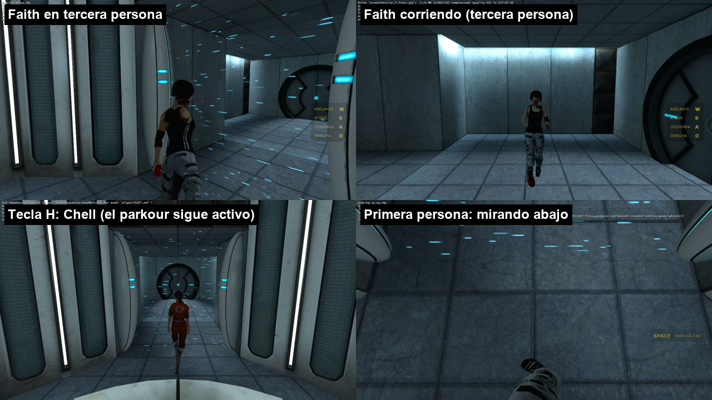

# ApertureRunner: Mirror's Edge dentro de Portal

**ApertureRunner** es un mod de fans que lleva el movimiento de **Faith** (*Mirror's Edge*, 2008) a **Portal** (2007). Juegas las cámaras de prueba de Aperture Science corriendo, saltando entre paredes y trepando como en Mirror's Edge, y puedes cruzar los portales sin perder la inercia.



## Qué hace

- **Movimiento de Faith:** sprint con inercia, salto, wallrun, wallclimb, agarrarse a bordes y subir, vault, slide, Skill Roll y giro de 180°.
- **Ajustado con datos reales de Mirror's Edge:** las constantes (velocidades, gravedad, duraciones) salen de grabaciones del juego original. Ver [`docs/tuning/P5_ajuste.md`](docs/tuning/P5_ajuste.md).
- **Portales con inercia:** los portales fijos del mapa y los que disparas con la pistola se cruzan corriendo, conservando la velocidad. Al caer sobre un portal de suelo actúa el embudo original de Portal.
- **Cámara de Mirror's Edge:** inclinación en el wallrun, FOV que se abre al esprintar, balanceo de cabeza y sacudida al aterrizar.
- **Faith visible:** sus brazos y piernas en primera persona, y su modelo en tercera persona y a través de los portales. La tecla **H** cambia entre Faith y Chell; el parkour funciona igual con las dos.
- **Sin archivos de los juegos:** el modelo de Faith se crea en el PC de cada jugador a partir de su propia copia de Mirror's Edge.

## Cómo funciona

Es un plugin de servidor para Portal (una DLL de 32 bits) que sustituye el movimiento del jugador por una simulación propia del de Faith. Cerca de un portal le devuelve el control al motor de Portal, para que el teletransporte funcione como en el juego original.

| Parte | Carpeta | Qué hace |
|---|---|---|
| Movimiento de Faith | [`mod/faith_move/`](mod/faith_move/) | Librería en C++ puro, sin dependencias del motor: estados de parkour, física y cruce de portales, con pruebas unitarias |
| Cámara | [`mod/camera/`](mod/camera/) | Inclinación, FOV, balanceo y sacudidas |
| Plugin de Portal | [`mod/plugin/`](mod/plugin/) | Engancha el movimiento del motor, traza la geometría real del mapa, gestiona los portales y dibuja a Faith |
| Extractor del modelo | [`mod/tools/extractor/`](mod/tools/extractor/) | Toma a Faith de tu Mirror's Edge (UE Viewer), la convierte a formato Source y la compila con las herramientas de Portal |
| Telemetría | [`mod/tools/me_telemetry/`](mod/tools/me_telemetry/) | Graba en solo lectura posición, velocidad y estado de Faith en Mirror's Edge, para ajustar el movimiento |
| Instalador | [`mod/tools/installer/`](mod/tools/installer/) | Instala el mod y crea el modelo de Faith |
| Pruebas en el juego | [`qa/`](qa/) | Scripts que abren Portal, ejecutan cada movimiento y generan informes |

## Requisitos

- **Portal** de Steam para Windows (probado con la build 19017868).
- **Opcional, para ver a Faith:** tu propia copia de **Mirror's Edge** para PC, **Python 3.10+** y **UE Viewer**.

## Instalar y jugar

1. Descarga el paquete de la sección *Releases* o genéralo tú (ver abajo).
2. Cierra Portal y ejecuta `instalar.bat`. Las instrucciones completas están en [`mod/tools/installer/LEEME.md`](mod/tools/installer/LEEME.md).
3. Abre Portal, carga `testchmb_a_00` y escribe en la consola `ar_enable 1`.

| Tecla de Portal | Faith |
|---|---|
| Saltar | saltar, wallrun, wallclimb, subir a un borde, salto de pared |
| Agacharse | slide, coil en el aire, Skill Roll justo antes de aterrizar |
| Recargar | giro de 180° |
| H | cambiar entre Faith y Chell |

Comandos de consola: `ar_enable 0|1`, `ar_camera 0|1`, `ar_personaje faith|chell` y `ar_status`.

## Compilar desde el código

Hace falta Visual Studio con C++ y CMake.

```bash
mod\build.bat
```

```bash
powershell -ExecutionPolicy Bypass -File mod\tools\installer\package.ps1
```

`build.bat` compila para Win32 y ejecuta las pruebas unitarias. `package.ps1` crea el zip en `dist\`. Para probarlo en el juego: `qa\scripts\probar_todo.ps1`.

## Estado

Hitos completados, con pruebas automáticas en Portal:

| Hito | Contenido |
|---|---|
| H1 "La DLL vive" | Portal carga el plugin y el mapa sigue funcionando |
| H2 "Corre como Faith" | Sprint con inercia y salto |
| H3 "Parkour completo" | Wallrun, wallclimb, bordes, slide, Skill Roll y portales con inercia |
| H4 "Se siente como Mirror's Edge" | Ajuste con datos reales, Faith en primera y tercera persona, instalador con extractor |

Los informes están en [`qa/resultados/`](qa/resultados/); el detalle de H4, en [`qa/resultados/H4.md`](qa/resultados/H4.md).

## Aviso legal

Proyecto de fans sin ánimo de lucro, sin relación con Valve ni con Electronic Arts. *Portal* es de Valve y *Mirror's Edge* de EA DICE. El repositorio no incluye archivos de ninguno de los dos juegos: para jugar necesitas Portal, y para ver el modelo de Faith, tu propia copia de Mirror's Edge.
