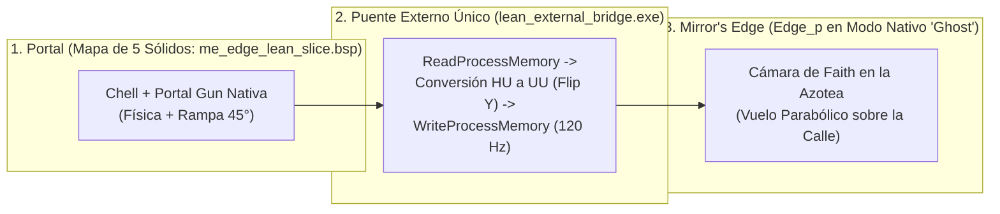

# Flujo Rediseñado: "Lean Vertical Slice" en 3 Pasos (Cero SDKs, Cero Hooks de Motor)

> Rediseño enfocado en **máxima velocidad de implementación** y **mínima complejidad técnica**, tomando lo mejor del Flujo #1 (`Edge_p`) y del Flujo #2 (`Stormdrain_p` rampa a $45^\circ$) mientras elimina el ~75% del trabajo pesado de ingeniería inversa.

---

## 1. Qué Eliminamos y Qué Conservamos para el Vertical Slice

| Elemento | ¿Qué hicimos? | Cómo se reemplaza de forma ultraligera |
| :--- | :--- | :--- |
| **Source SDK 2007 (`VSP.dll`)** | **Eliminado** | Un único ejecutable externo ([`lean_external_bridge.cpp`](../../src/lean_bridge/lean_external_bridge.cpp)) lee la posición/cámara de Chell desde fuera con `ReadProcessMemory`. |
| **Hook C++ de `UObject::ProcessEvent`** | **Eliminado** | Se usa el comando nativo **`Ghost`** de *Mirror's Edge* en `TdInput.ini` (`F10 = Ghost \| FOV 90`), que apaga la gravedad y las colisiones de Faith con **0 líneas de C++**. |
| **Inyección de Input (`CUserCmd`)** | **Eliminado** | El jugador controla directamente la ventana/input de *Portal* (donde la Portal Gun, sonidos, mirilla y físicas ya funcionan al 100% de fábrica) y la cámara de *Mirror's Edge* replica el movimiento a $120\text{ Hz}$. |
| **Kismet, Cubo y Level Streaming (`Stormdrain_p`)** | **Eliminado** | Nos quedamos en la **azotea inicial de `Edge_p`** (que carga en el segundo `0`), pero **convertimos su rampa roja de salto en una superficie portaleable a $45^\circ$** para cruzar volando a la azotea del edificio vecino. |

---

## 2. Arquitectura del Flujo Rediseñado (3 Pasos)



---

## 3. Ejecución Rápida en 3 Pasos

1. **Paso 1 — Generar y validar el mapa de 5 sólidos en 1 comando**:
   ```powershell
   node .agents/skills/portal-me-lean-slice/scripts/build-and-verify-lean-slice.js
   ```
2. **Paso 2 — Activar modo `Ghost` nativo en `TdInput.ini` de *Mirror's Edge***:
   ```ini
   Bindings=(Name="F10",Command="Ghost | FOV 90",Control=False,Shift=False,Alt=False)
   ```
3. **Paso 3 — Compilar y correr el puente externo único (`lean_external_bridge.cpp`)**:
   ```powershell
   cl /EHsc /O2 src/lean_bridge/lean_external_bridge.cpp /Fe:lean_bridge.exe
   ./lean_bridge.exe --self-test
   ```
