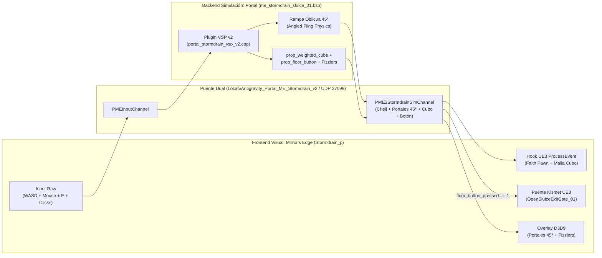

# Flujo de Trabajo #2 Multi-Instancia: Mod Pass-Through en `Stormdrain_p` (Esclusa Vertical + Catapultas a 45° + Cubo de Compañía)

> [!IMPORTANT]
> **Coexistencia con el Flujo #1**: Este segundo flujo de trabajo ([`.agents/skills/portal-mirrors-edge-stormdrain/SKILL.md`](../../.agents/skills/portal-mirrors-edge-stormdrain/SKILL.md)) es paralelo e independiente del Flujo #1 ([`.agents/skills/portal-mirrors-edge-passthrough/SKILL.md`](../../.agents/skills/portal-mirrors-edge-passthrough/SKILL.md)). Todos los archivos del Flujo #1 (`Edge_p` — Azotea Inicial) se mantienen **100% intactos**.

---

## 1. Comparativa entre los Dos Flujos de Trabajo del Repositorio

Ambos flujos resuelven el mismo caso (**jugar con el personaje y físicas de *Portal* dentro de una sección única de un nivel de *Mirror's Edge***), pero abordan escenarios y mecánicas complementarias:

| Dimensión | Flujo #1 (Intacto): `edge_p_rooftop_01` | Flujo #2 (Nuevo): `stormdrain_p_sluice_01` |
| :--- | :--- | :--- |
| **Nivel de *Mirror's Edge*** | Prólogo (`Edge_p` — Azotea de Entrenamiento) | Cap. 2 *Jacknife* (`Stormdrain_p` — Gran Esclusa Vertical) |
| **Geometría `.vmf`** | Cajas ortogonales AABB (`box`) | Cajas ortogonales + **Cuñas/Rampas oblicuas a 45° (`wedge_45_plus_x`)** |
| **Mecánica de Portales** | Fling simple desde torre vertical ($90^\circ$) | **Catapulta Parabólica a $45^\circ$ (*Angled Long-Jump Fling*)** sobre abismo de $52\text{ m}$ |
| **Objetos y Puzzle** | Solo Jugador (`Chell`) + 2 Portales | `Chell` + 2 Portales + **Cubo de Compañía (`prop_weighted_cube`)** + **Botón (`prop_floor_button` $\rightarrow$ Kismet)** + **2 Fizzlers** |
| **Contrato C/C++** | [`src/common/ipc_bridge_protocol.h`](../../src/common/ipc_bridge_protocol.h) (`PME1`) | [`src/common/ipc_stormdrain_bridge_v2.h`](../../src/common/ipc_stormdrain_bridge_v2.h) (`PME2`, SharedMemory + UDP `27099`) |
| **Mapa Proxy Source** | [`levels/edge_p_rooftop_01/me_edge_rooftop_01.vmf`](../../levels/edge_p_rooftop_01/me_edge_rooftop_01.vmf) | [`levels/stormdrain_p_sluice_01/me_stormdrain_sluice_01.vmf`](../../levels/stormdrain_p_sluice_01/me_stormdrain_sluice_01.vmf) |

---

## 2. Arquitectura del Flujo #2 (`Stormdrain_p` — Esclusa Vertical)



---

## 3. Física de Catapulta en Rampa a $45^\circ$ (*Angled Fling*)

En la Gran Esclusa de `Stormdrain_p`, el jugador inicia en la cornisa oeste ($Z_{\text{local}} = 1143\text{ UU} = 600\text{ HU}$) junto al **Cubo de Compañía**, separado por un abismo de hormigón de la plataforma superior este (`upper_exit_catwalk_east`).

1. **Caída libre al pozo**: Al saltar desde la cornisa ($h = 600\text{ HU}$) hacia el portal en el fondo del canal (`sluice_basin_floor`, $\vec{n}_{\text{in}} = (0, 0, 1)$), la velocidad de impacto en Source ($g = 600\text{ HU/s}^2$) es:
   $$v_{\text{in}} = \sqrt{2 \cdot g \cdot h} = \sqrt{2 \cdot 600 \cdot 600} \approx 848.53\text{ HU/s}$$
2. **Reorientación en la rampa a $45^\circ$**: El portal de salida está sobre `sluice_angled_fling_ramp_45` con normal unitaria $\vec{n}_{\text{out}} = \left(\frac{\sqrt{2}}{2}, 0, \frac{\sqrt{2}}{2}\right)$. La función `PME2_ComputePortalExitVelocity` proyecta el vector de salida:
   $$\vec{v}_{\text{out, HU}} = (600.0, 0.0, 600.0)\text{ HU/s} \implies \vec{v}_{\text{out, UU}} = (+1143.0, 0.0, +1143.0)\text{ UU/s}$$
3. **Resolución del Puzzle**: Chell vuela en parábola sosteniendo el `prop_weighted_cube`, aterriza en la pasarela este y deposita el cubo sobre el `prop_floor_button`, lo que activa `sluice_exit_gate_open = 1` y dispara el evento Kismet `OpenSluiceExitGate_01` en *Mirror's Edge*.

---

## 4. Comandos de Verificación para Cualquier Computadora

```powershell
# Verificar Flujo #1 (Prólogo Edge_p - Azotea)
node .agents/skills/portal-mirrors-edge-passthrough/scripts/verify-bridge-pipeline.js

# Regenerar y Verificar Flujo #2 (Cap. 2 Stormdrain_p - Gran Esclusa Vertical)
node .agents/skills/portal-mirrors-edge-stormdrain/scripts/generate-stormdrain-vmf.js
node .agents/skills/portal-mirrors-edge-stormdrain/scripts/verify-stormdrain-pipeline.js
```
