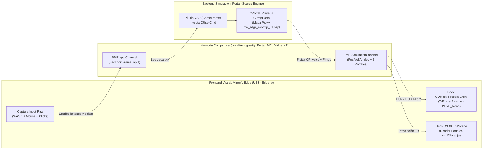

# Flujo de Trabajo Multi-Instancia: Mod Pass-Through (Portal en Mirror's Edge)

> [!IMPORTANT]
> **Alcance Estricto (Single-Slice Scope)**: Este flujo de trabajo está acotado exclusivamente a **una sola sección de un solo nivel**: la **Azotea Inicial de Entrenamiento del Prólogo (`Edge_p` — `edge_p_rooftop_01`)** en *Mirror's Edge*, antes del primer salto de edificio con Celeste.

---

## 1. Síntesis de la Investigación Técnica

Para conectar **Portal (Source Engine 2007)** como *Backend de Simulación Física* y **Mirror's Edge (Unreal Engine 3 — DICE Branch)** como *Frontend Visual y Mundo* mediante el patrón **Pass-Through Mod**, se resolvieron cuatro diferencias estructurales entre ambos motores:

| Dimensión | Backend: *Portal* (`hl2.exe`) | Frontend: *Mirror's Edge* (`MirrorsEdge.exe`) | Regla de Conversión / Puente |
| :--- | :--- | :--- | :--- |
| **Motor y API** | Source Engine (2007) | Unreal Engine 3 + Direct3D 9 (`d3d9.dll`) | Procesos paralelos unidos por `SharedMemory` (`SeqLock`) |
| **Escala de Unidades** | `1 Hammer Unit (HU) = 1.905 cm` | `1 Unreal Unit (UU) = 1.0 cm` *(escala métrica de DICE)* | $\text{UU} = \text{HU} \times 1.905$ / $\text{HU} = \text{UU} \times 0.52493438$ |
| **Sistema de Coordenadas** | **Right-Handed Z-Up** (`+X` Front, `+Y` Left, `+Z` Up) | **Left-Handed Z-Up** (`+X` Front, `+Y` Right, `+Z` Up) | Inversión del eje $Y$ relativo al anclaje (`Y_ME = Anchor_Y - Y_P * 1.905`) |
| **Rotación de Cámara** | `QAngle` en grados `[-180, 180]` (`+Pitch` = abajo, `+Yaw` = CCW) | `FRotator` en `URU` (`65536 = 360°`, `+Pitch` = arriba, `+Yaw` = CW) | $\text{Pitch}_{ME} = -\text{pitch}_P \times 182.0444$, $\text{Yaw}_{ME} = -\text{yaw}_P \times 182.0444$ |
| **Punto de Inyección** | **Valve Server Plugin (VSP)** (`IServerPluginCallbacks::GameFrame`) | Hook en `UObject::ProcessEvent` (`TdPlayerTick`) + `IDirect3DDevice9::EndScene` | `Faith` (`TdPlayerPawn`) pasa a `PHYS_None` y adopta el transform de `Chell` (`CPortal_Player`) |

---

## 2. Arquitectura del Sistema Pass-Through en Tiempo Real



---

## 3. Diseño para Trabajo Distribuido entre Múltiples Instancias de Antigravity

Para que cualquier instancia de Antigravity (en distintas computadoras, cuentas o sistemas operativos) pueda trabajar sobre una parte del mod sin requerir que todas las máquinas tengan ambos juegos instalados simultáneamente, el flujo se apoya en **Contratos en Git** y **5 Fases Modulares**:

1. **Rutas locales desacopladas**: Cada computadora define las rutas de sus binarios en `config/paths.local.json` (ignorado por `.gitignore`) basándose en `config/paths.example.json`.
2. **Validación sin juegos instalados (Offline CI)**: Cualquier instancia puede ejecutar el verificador matemático y generador de mapas en Node.js antes de hacer commit:
   ```powershell
   node .agents/skills/portal-mirrors-edge-passthrough/scripts/generate-proxy-vmf.js
   node .agents/skills/portal-mirrors-edge-passthrough/scripts/verify-bridge-pipeline.js
   ```
3. **Exclusión de binarios pesados**: `.gitignore` bloquea `.upk`, `.umap`, `.bsp`, `.dll` y `.pdb`, manteniendo en Git únicamente el código fuente C++, el manifiesto JSON y el mapa de texto `.vmf`.

---

## 4. Guía Paso a Paso de las 5 Fases del Flujo de Trabajo

### Fase 1: Geometría Proxy de la Azotea Inicial (`edge_p_rooftop_01`) — *[Completada y Verificada]*
- **Artefactos**:
  - `levels/edge_p_rooftop_01/slice_manifest.json`: Define el anclaje `(-14200, 8400, 3200)` en `Edge_p` y los 6 volúmenes clave de la primera azotea (piso principal, muro norte de la torre del ascensor para *flinging*, muros este/oeste portaleables, y obstáculos metálicos HVAC/vallas `noportal`).
  - `levels/edge_p_rooftop_01/me_edge_rooftop_01.vmf`: Mapa de Source Engine autogenerado con conversión exacta `UU -> HU` e inversión de eje $Y$.

### Fase 2: Backend de Simulación en Portal (VSP Plugin) — *[Esqueleto IPC Listo]*
- **Archivo base**: `src/backend_source/portal_me_vsp.cpp`
- **Trabajo para la instancia asignada**:
  1. Enlazar contra el Source SDK 2007 (`IServerPluginCallbacks`, `IPlayerInfoManager`).
  2. En `GameFrame()`, leer `g_pBridge->input` y sobreescribir el `CUserCmd` de Chell (`buttons |= PME_IN_ATTACK` para disparar portal azul, `PME_IN_ATTACK2` para naranja).
  3. Recorrer las entidades `prop_portal` activas en el mapa `me_edge_rooftop_01` y llamar a `PME_Backend_PublishSimulationTick()`.

### Fase 3: Frontend Visual en Mirror's Edge (Hook UE3) — *[Esqueleto IPC Listo]*
- **Archivo base**: `src/frontend_me/me_d3d9_bridge.cpp`
- **Trabajo para la instancia asignada**:
  1. Compilar como proxy `d3d9.dll` (x86, 32 bits) junto a MinHook.
  2. Al detectar que el jugador está en `Edge_p` dentro de la caja delimitadora de `edge_p_rooftop_01`, poner `TdPlayerPawn->Physics = PHYS_None`.
  3. Llamar a `PME_Frontend_ReadAndTransformSimulation(&target)` en cada tick y aplicar `target.pawn_location_uu`, `target.pawn_velocity_uu` y `target.controller_rotation_uru`.

### Fase 4: Renderizado de Portales en Mirror's Edge (D3D9 EndScene)
- **Trabajo para la instancia asignada**:
  1. En `IDirect3DDevice9::EndScene`, usar `target.blue_portal_pos_uu` / `blue_portal_normal_lh` y `target.orange_portal_pos_uu` / `orange_portal_normal_lh`.
  2. Dibujar un quad/elipse orientado sobre la pared (radio mayor `54 HU = 102.87 UU`, radio menor `32 HU = 60.96 UU`) con borde azul (`#00A2FF`) y naranja (`#FF6A00`), más la retícula de estado de la Portal Gun en el centro de la pantalla.

### Fase 5: Calibración In-Game y Pruebas de Impulso (Flinging)
- **Trabajo para la instancia con ambos juegos**:
  1. Lanzar `hl2.exe -game portal -windowed -novid +map me_edge_rooftop_01`.
  2. Lanzar `MirrorsEdge.exe` y cargar el Prólogo (`Edge_p`).
  3. Disparar el Portal Azul en la parte alta de la torre del ascensor (`elevator_tower_wall_north`) y el Portal Naranja en el piso (`rooftop_main_floor`), saltar desde la cornisa hacia el portal del piso y verificar la conservación de momento en el mundo de *Mirror's Edge*.
