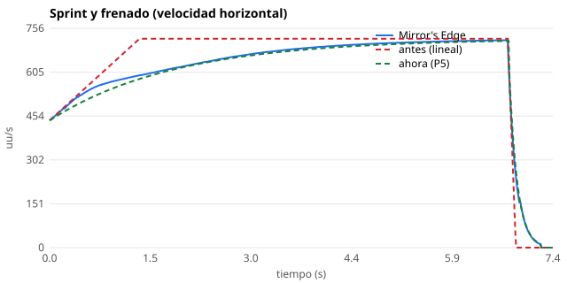
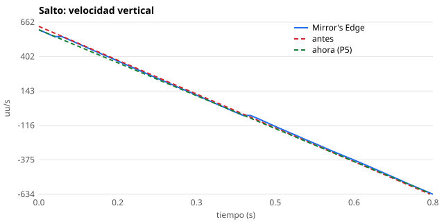
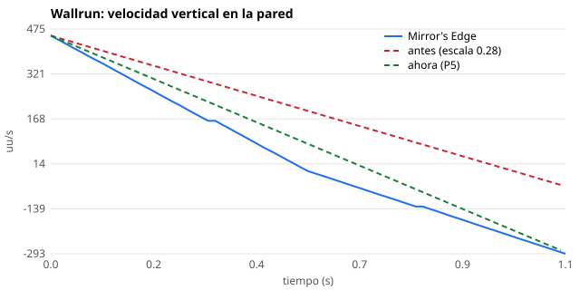
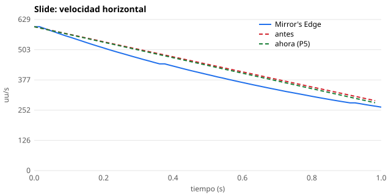

# P5: ajuste del movimiento de Faith con grabaciones reales de Mirror's Edge

- **Tarea:** P5 (Peña), hecha por Sebas con Claude Code el 2026-11-09.
- **Datos:** las 9 trazas `qa/telemetria/*_live.csv`, grabadas en vivo con `record_me_csv.py --record` (ME GOG v1.01, unas 64 muestras/s, 10 s cada una).
- **Cómo se reproduce:** `python mod/faith_move/tuning/fit_live.py`. Ese comando regenera [`P5_tabla.md`](P5_tabla.md) y las gráficas.
- **Dónde quedaron los valores:** `mod/faith_move/include/faith_move/faith_params.h`, en el bloque `me_live`. Los valores de referencia de `ar/units.h` (`me_reference`) no se tocaron, porque son el contrato de S2.

## Tabla de ajuste

Unidades: uu = Mirror's Edge, su = Source (uu / 2.54).

| Valor | Medido en ME | Grabación | Antes | Ahora |
|---|---|---|---|---|
| Gravedad de Faith | 1597 uu/s² | `jump`, `skill_roll` | 646 su/s² | **628.7 su/s²** |
| Salto (vz inicial) | 604 uu/s | `jump` (3 saltos) | 248 su/s | **237.8 su/s** |
| Salto: velocidad horizontal añadida | 100 uu/s | `jump` | 39.4 su/s | sin cambio ✓ |
| Sprint máximo | 722 uu/s | `sprint_start` | 283.5 su/s | sin cambio ✓ |
| Sprint: forma de la curva | τ = 1.86 s | `sprint_start` | rampa lineal de 1.5 s | **exponencial, τ = 1.86 s** (de 157.5 a 281.5 su/s en unos 7.7 s) |
| Frenado al soltar el stick | τ = 0.12 s | `sprint_start` | lineal, 2419 su/s² | **exponencial, τ = 0.12 s** (de 283.5 a 0 en unos 0.5 s) |
| Wallrun: gravedad | 661 uu/s² | `wallrun_right` (el único wallrun grabado entero) | escala 0.28 | **escala 0.414** |
| Wallrun: duración máxima | 1.12 s | `wallrun_right` | 1.2 s | sin cambio (la caída de vz lo termina solo) |
| Wallrun desde el suelo: vz | 515 uu/s | `wallrun_left` | 150 su/s | **202.8 su/s** |
| Salto desde la pared: vz | 518 uu/s | `wallrun_*` | igual que el salto (248) | **203.9 su/s** (constante nueva `kWallrunJumpZ`) |
| Wallclimb: vz inicial | 645 uu/s | `ledge_grab` | 260 su/s | **253.9 su/s** |
| Wallclimb: gravedad | 604 uu/s² | `ledge_grab` | escala 0.6 | **escala 0.378** (sube unos 135 su) |
| Subir el borde (duración) | 1.52 s | `ledge_grab` (2 veces) | 0.6 s | **1.52 s** |
| Vault (duración) | 0.57 s | `wallclimb` (2 veces) | 0.35 s | **0.55 s** |
| Slide: frenado | 313 uu/s² | `slide` (2 veces) | 120 su/s² | **123.2 su/s²** |
| Slide: velocidad de salida | 256 uu/s | `slide` | 98.4 su/s | sin cambio ✓ |
| Caída dura: tiempo bloqueado | 1.96 s | `hard_landing` | 0.5 s, sale a 59 su/s | **1.97 s, sale a 0** |
| Skill Roll: duración | 1.24 s | `skill_roll` | 0.6 s | **1.23 s** |
| Skill Roll: velocidad de salida | 240 uu/s | `skill_roll` | conservaba la del aterrizaje | **94.5 su/s** |

## Gráficas

Azul: Mirror's Edge. Rojo, discontinuo: modelo anterior. Verde, discontinuo: modelo ajustado (P5).

## Cambios de código

- `GroundAccelerate`: el sprint se acerca al máximo de forma exponencial, y al soltar el stick Faith frena también de forma exponencial. Antes las dos rampas eran lineales.
- El salto desde la pared usa `kWallrunJumpZ` en vez de `kJumpSpeed`.
- Durante el Skill Roll Faith avanza a `kSkillRollExitSpeed` y ya no conserva la velocidad del aterrizaje.
- La cámara (`mod/camera`) usa su propia copia de la duración del roll; se actualizó a 1.23 s.
- Pruebas: se actualizaron las que comprobaban los valores provisionales. Las 6 suites pasan (`mod\build.bat`).

## Límites y pendientes

- `wallclimb_live.csv` no contiene un wallclimb: el juego registró un **vault** (`MOVE_VaultOver`). El wallclimb que se usó viene de `ledge_grab_live.csv` (`MOVE_WallClimbing`, una sola vez). Conviene grabar 2 o 3 wallclimbs más.
- Cada wallrun se grabó una sola vez entero. Dos wallruns empezaron antes de que arrancara la grabación y los wallruns izquierdos fueron cortos.
- En `hard_landing` la caída ya había empezado al iniciar la grabación, así que la altura de caída dura (530 uu) no se pudo medir.
- No hay grabación de aterrizaje suave (`MOVE_SoftLanding`) ni de coil.
## Prueba en Portal (2026-11-09)

- **H2: 9/9 PASS.** Se ajustaron dos umbrales de `qa/scripts/h2_smoke.ps1`: H2-03 ahora espera la rampa exponencial y H2-04 el salto de 237.8 su/s.
- **H3: 11/15.** Fallan H3-06 (agacharse baja la vista), H3-11 (FOV), H3-12 (balanceo) y H3-14 (mensaje "Restoring player view height"). **No los causa P5:** con la DLL de `main` sin estos cambios, el mismo diagnóstico falla igual (la vista no baja al agacharse y el FOV queda en 75). Esa misma tarde, a las 19:41, habían pasado 15/15. Lo que cambió fue el entorno: Mirror's Edge estaba abierto mientras corría la prueba. Hay que repetirla con Mirror's Edge cerrado.
- Ojo con H3-11: con el sprint real (más lento de llenar), en el pasillo de la prueba Faith llega a la pared con unos 225 su/s, así que el FOV solo se abre unos 3°. Si sigue fallando con Mirror's Edge cerrado, hay que buscar un pasillo más largo para esa prueba.
